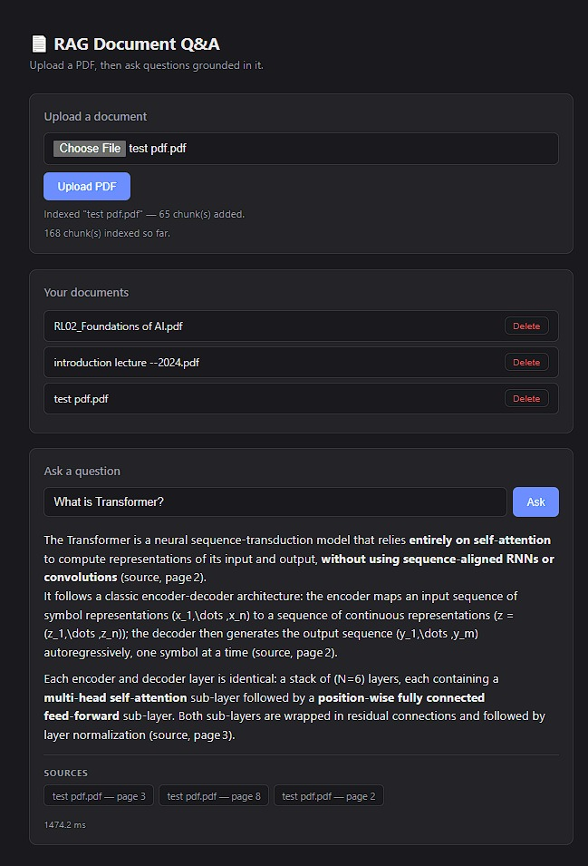

# RAG Document Q&A — Learning Project

A document question-answering system built to learn production AI engineering end to end: retrieval-augmented generation, local and hosted LLM inference, Docker containerization, and basic MLOps practices — not just a notebook demo.

Upload a PDF, ask questions about it, get answers grounded in the actual document with page-level citations.



## Why this project

Most RAG tutorials stop at "it works in a notebook." This one goes further:
- A real FastAPI backend with a proper HTTP API (`/upload`, `/ask`, `/documents`, `/health`)
- A usable web UI, not just curl commands
- Fully containerized with Docker, deployable anywhere
- Swappable LLM backend (works with Groq's free API, or a local model via Ollama) — see `app/llm.py`
- A query logging + eval harness, the seed of real MLOps practice

## Stack
- **FastAPI** — the API layer
- **ChromaDB** — local vector store (persisted to disk / a volume)
- **sentence-transformers** — embeddings, runs locally, free
- **Groq API** — fast, free LLM inference (swappable — see `app/llm.py`)
- **Docker + docker-compose** — containerization
- **A tiny eval harness** — fixed question set scored on every change

## Project layout
```
rag-project/
├── app/
│   ├── main.py         # FastAPI app: routes
│   ├── config.py       # settings (env vars)
│   ├── ingest.py        # PDF loading + chunking
│   ├── vectorstore.py   # Chroma wrapper (add / query)
│   ├── llm.py           # LLM call (Claude), swappable
│   ├── rag.py           # ties retrieval + generation together
│   └── logger.py        # structured query logging (MLOps step 1)
├── eval/
│   ├── eval_set.json    # fixed Q/A pairs to test against
│   └── run_eval.py      # scores current pipeline against eval_set.json
├── data/
│   ├── uploads/         # uploaded PDFs land here
│   └── chroma/          # persisted vector DB
├── logs/                # query logs (created at runtime)
├── requirements.txt
├── Dockerfile
├── docker-compose.yml
├── .env.example
└── README.md
```

## Requirements

- **Python 3.11 or 3.12** (Python 3.13 is not yet fully supported by some dependencies — if you hit numpy/install errors, downgrade)
- **A free Groq API key** — get one at [console.groq.com](https://console.groq.com) (no credit card required)
- **Docker Desktop** — only needed if you want to run it containerized (optional for local development)

## Getting Started

### 1. Clone and install

```bash
git clone <your-repo-url>
cd rag-project

python -m venv venv
source venv/bin/activate          # Windows: venv\Scripts\activate
pip install -r requirements.txt
```

### 2. Add your API key

```bash
cp .env.example .env
```

Open `.env` and paste your Groq key into `GROQ_API_KEY=`. Everything else can stay at its default value.

### 3. Run it

```bash
uvicorn app.main:app --reload --port 8000
```

Open **http://127.0.0.1:8000** in your browser — you'll see the chat UI. Upload a PDF, then ask it questions.

### 4. (Optional) Run with Docker instead

```bash
docker compose up --build
```

Same app, same URL, now running in a container. Useful if you want to confirm it works the way it will when deployed, or if you'd rather not set up a Python virtual environment at all.

### 5. (Optional) Run the eval

```bash
python eval/run_eval.py
```

Scores the pipeline against the questions in `eval/eval_set.json` — add your own questions there once you've uploaded a document you know well.